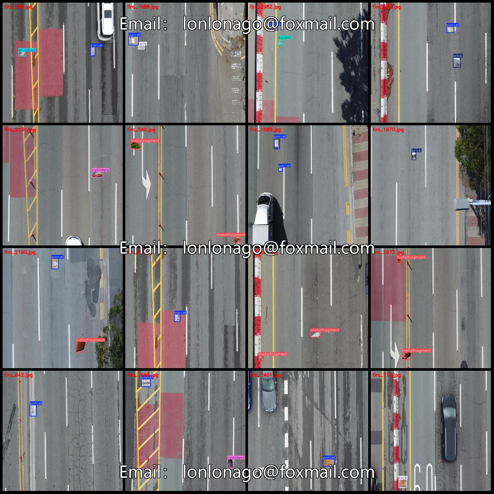
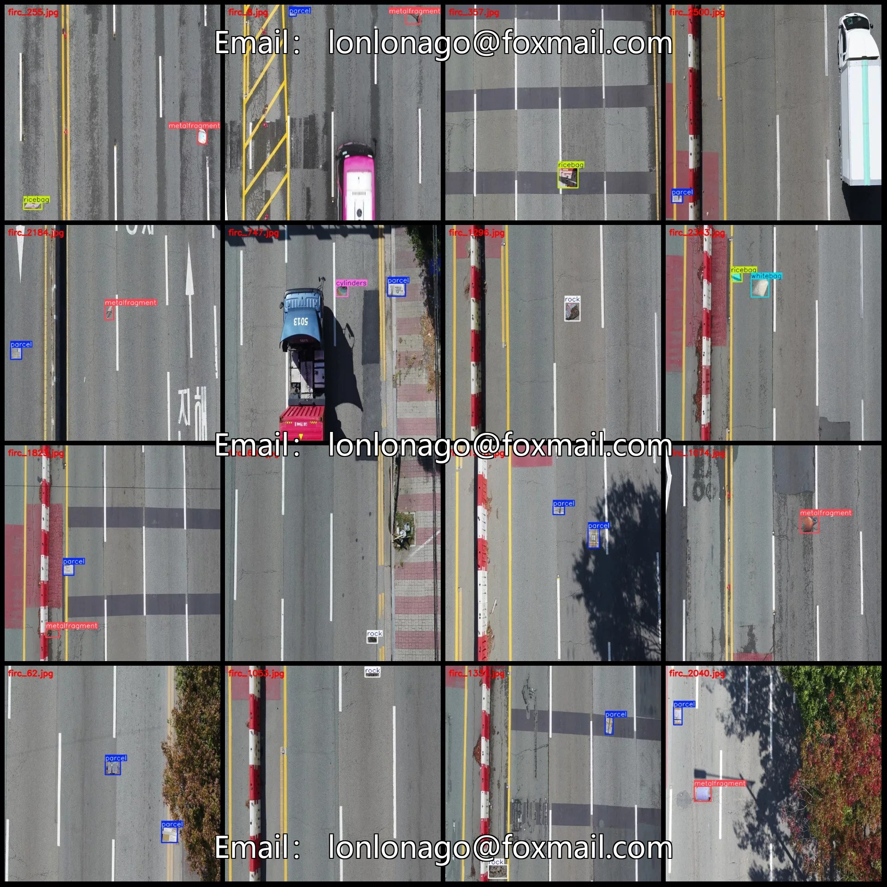
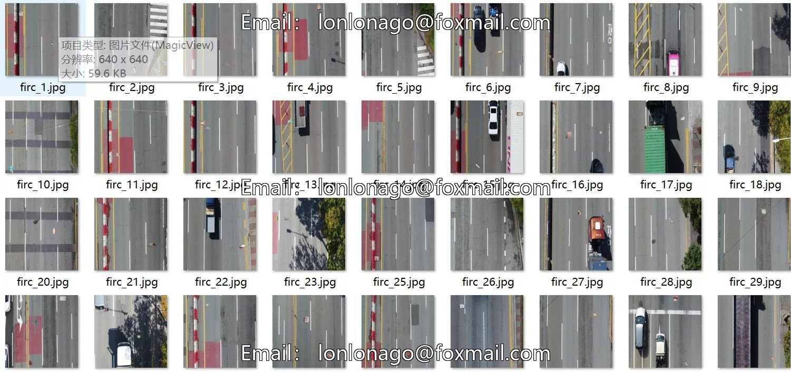
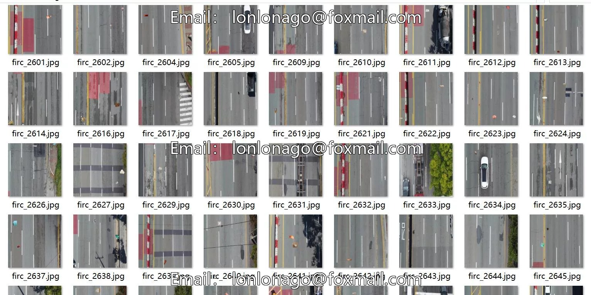

# UAV-viewpoint aerial photography dataset for urban roads and highways, including detection of debris and foreign objects

## Body

Drone-Viewpoint Aerial Photography Dataset for Urban Roads and Highways: Spillage Object Detection in VOC+YOLO Format with 2507 Images in 8 Categories

Warm Reminder: Due to the dataset's replicability, please confirm compliance before purchasing.

Note: The spillage objects in the dataset are synthetically incorporated into the images; please refer to the images for specific details.

Dataset Format: Pascal VOC format + YOLO format (excluding the segmentation path in the txt file, only including jpg images along with their corresponding VOC format xml files and yolo format txt files)
Number of Images (JPG File Count): 2507
Number of Annotations (XML File Count): 2507
Number of Annotations (TXT File Count): 2507
Number of Annotation Categories: 8

Annotation category names (Note that the order of categories in the YOLO format does not correspond to this, but is based on the labels folder's classes.txt): ["brick", "bucket", "cylinders", "metalfragment", "parcel", "ricebag", "rock", "whitebag"]
Number of bounding boxes per category:
- brick (Brick) = 136
- bucket (Bucket) = 56
- cylinders (Cylinders/Bucket-shaped objects) = 173
- metalfragment (Metal fragment) = 1203

Parcel (package) Frames = 1387
Ricebag (rice bag) Frames = 131
Rock (rock) Frame Count = 450
Whitebag (white bag) Frames = 211
Total frame count: 3747
Number of images per category
brick (tile) occupies = 134
Bucket (bucket) occupies a picture count = 56
Cylinders (Cylinder/Bucket) occupies the image count = 173
Metalfragment (metal fragment) occupies 1081 images.
Parcel (Package) Ownership Image Count = 1221

Ricebag (rice bag) occupies = 129
Rock (rock) occupies = 425
Whitebag (white bag) occupies = 205
Image resolution: 640x640
Labeling tool used: labelImg
Labeling rules: Draw a rectangle around the category.
Important note: The dataset does not have splits for training, validation, or testing; you need to manually divide it.
Special statement: This dataset does not guarantee the accuracy of the trained models or weight files.

## Images

## Payment

Here is a pay link on Stripe ( https://buy.stripe.com/3cs8yP7sY87d0vu9AB ). Please contact me lonlonago@foxmail.com after funding $89, and I will send you a complete data files , thank you!

